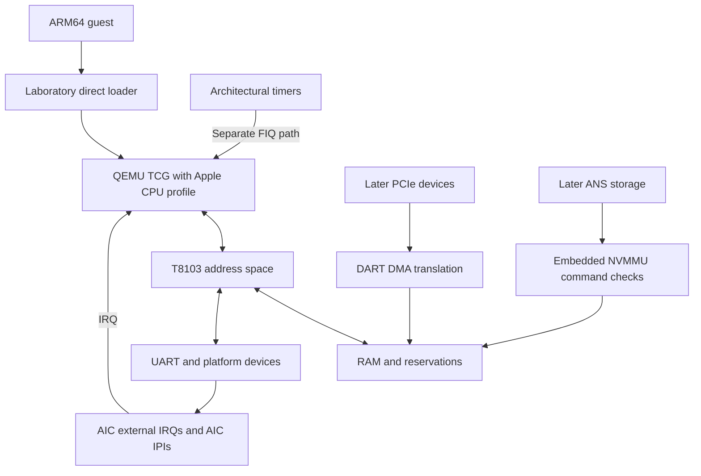

# Emulator architecture and acceptance gates

## Scope

**SoC:** original Apple M1 T8103/H13G. **Board:** 2020 M1 Mac mini/J274. **Host:** Linux x86_64/WSL2. **CPU execution:** QEMU AArch64 TCG plus Apple-specific identity and system registers. **Guest:** bare-metal tests, then a T8103-targeted Linux kernel and initramfs. **Release goal:** headless Linux boot using Apple-compatible peripherals, not generic QEMU `virt` hardware.

The `experiments/arm64-virt-smoke` executable runs on QEMU **`virt` only**; it establishes a reproducible toolchain and must not be called M1 emulation.

## Functional architecture

QEMU handles ordinary ARM64 instruction execution and memory translation. Project-specific code handles the M1 CPU profile, board initialization, MMIO state machines and Apple-specific guest-visible interfaces. Instruction-accurate emulation does not require replicating Firestorm's internal out-of-order pipeline or cycle timing.

The M1 architectural timers bypass AIC and signal CPU FIQ. Linux's AIC driver also dispatches these FIQs, but that software integration must not be mistaken for timer routing through AIC hardware. Apple fast-IPI system-register pathways are separate from AIC-generated IPIs and need their own source-backed model if advertised. See the [Asahi AIC notes](https://asahilinux.org/docs/hw/soc/aic/) and [system-register notes](https://asahilinux.org/docs/hw/cpu/system-registers/).

Do not attach every DMA-capable device to DART by analogy. T8103 ANS has an embedded NVMMU with command-tag-indexed TCBs; SART separately authorizes RTKit shared-memory regions and applicable vendor-command buffers. The Apple NVMe submission array is indexed by command tag, not an ordinary NVMe submission ring. Preserve these distinctions when modeling storage; see the [Linux Apple NVMe driver](https://github.com/torvalds/linux/blob/master/drivers/nvme/host/apple.c).

## Hardware-modeling contract

1. Use `hardware/t8103.json` for source-linked, confidence-marked physical-address facts. An address is not proof of register semantics.
2. For every implemented register, specify reset state, read/write width, mask, side effects, invalid accesses, and tests; model W1C/W1S, level/edge and interrupt acknowledgment correctly.
3. Never silently return zero from all missing MMIO. Unknown accesses need explicit diagnostics and consistent fault/stub policy.
4. Only advertise ARM/Apple architectural features that are implemented and tested. Implementation-defined registers must have observed behavior or clearly documented stubs.
5. Never mark a phase done from source code alone; record tests and, if possible, sanitized physical-hardware comparison traces.

## Boot strategy

**Laboratory boot:** Load test ELF or decompressed Linux Image into RAM, set PC, registers and initial state, supply the DTB physical address in `x0` under the AArch64 Linux boot protocol. This explicitly bypasses Apple's normal Boot ROM/iBoot/SEP startup and is *not* full firmware emulation.

**Apple-compatible preboot:** Later reproduce the state expected by an M1-targeted kernel or m1n1 payload, model ADT/FDT distinctions, initialize peripherals and optional coprocessors; do not distribute Apple-proprietary firmware.

**macOS:** Separate exploratory track outside v0.1. QEMU `vmapple` virtual-machine support is not a physical T8103 model and requires an Apple Silicon macOS host in its documented configuration.

## Measurable development gates

| Gate | Required observable test | Fidelity status |
|---|---|---|
| G0 | `ARM64 baseline OK` on QEMU `virt` | Toolchain only; **not M1** |
| G1 | Original ARM64 test ELF executes on new `apple-m1-lab` machine | First Apple CPU/board skeleton |
| G2 | Serial output via verified T8103 Apple UART MMIO | First M1 peripheral |
| G3 | AIC device IRQ, separate timer FIQ and two-core IPI acknowledge correctly | Apple interrupt subsystem |
| G4 | T8103-targeted Linux reaches BusyBox shell via Apple UART/AIC | **v0.1 breakthrough** |
| G5 | Sanitized M1 hardware traces match emulator device tests | Validated coverage |
| G6 | Persistent root filesystem through ANS/NVMMU with required SART/RTKit initialization | Extended headless system |

## Important risks

- **CPU gaps:** Apple-specific ID/sysregs, permissions, pointer authentication and exception behavior may differ from generic QEMU CPU profiles. Trap, characterize and test.
- **Firmware state:** M1 Linux expects much pre-kernel initialization. Start with directly configured Linux and progressively recreate required states, rather than claiming stock boot.
- **Apple AIC:** Do not substitute ARM GIC and claim hardware fidelity. Model its masks, targeting, acknowledgment and IPI delivery.
- **MMIO uncertainty:** Cross-check Asahi documentation, Linux DT/driver source and real-mac traces. Separate observed facts from hypotheses.
- **Long tail:** AGX, SEP, RTKit, macOS and cycle-accurate microarchitecture remain independent open-ended research efforts.

## Differential validation workflow

On a safe, isolated owner-controlled M1 research installation, run a narrowly scoped experiment; collect m1n1 CPU/MMIO events; **sanitize device identifiers, keys and all unrelated data**; replay the same operations on QEMU; compare register results, interrupts and state transitions; add regression tests. Preserve source revisions and firmware/kernel version in trace metadata. Never change NOR flash or production boot policies merely to gather an emulator trace.
