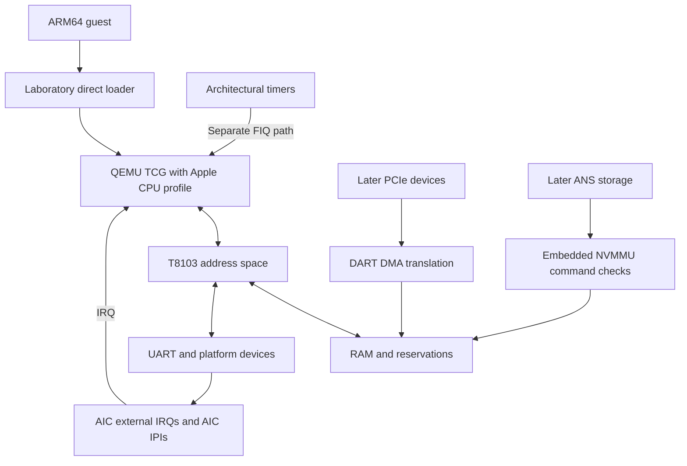

# Emulator architecture and acceptance gates

> Research target: Apple M1 (T8103/H13G); Mac mini (M1, 2020), J274.

> v0.1 scope: cycle accuracy, GPU graphics and unmodified macOS are exploratory, unimplemented and not required.

## P001 target charter

The first machine is the **original Apple M1 SoC in the 2020 Mac mini board J274**. This selection is a project requirement, not a claim of implemented compatibility. `hardware/t8103.json` is the machine-readable identity record; the following names refer to different layers of that one target.

| Identity layer | Selected value | Evidence |
|---|---|---|
| Marketed SoC | Apple M1 | Linux Apple binding; Apple product specifications |
| SoC identifier | `T8103` | Linux Apple binding |
| Internal SoC name | `H13G` | Linux Apple binding; Asahi SoC names |
| Reference product | Mac mini (M1, 2020) | Apple specifications; Linux J274 description |
| Board / ADT target type | `J274` | Linux J274 description |
| Model identifier | `Macmini9,1` | Asahi device list |
| Product identifier | `J274AP` | Asahi device list |
| Linux root compatible, in order | `apple,j274`, `apple,t8103`, `apple,arm-platform` | Linux J274 description |

The exact source URLs and immutable revisions are recorded in [P001 identity evidence](REFERENCES.md#p001-identity-evidence). `H13G` is an internal SoC name, not a CPU instruction set or board. `J274AP` and `Macmini9,1` identify the product/model; neither replaces `J274` in the Linux board compatible. The Linux binding lowercases the ADT target type and SoC ID for compatible strings. The sources establish identity; they do not establish reset state, register semantics, ISA extension coverage or timing.

### Excluded variants and boards

P001 selects exactly one SoC/board pair. All other pairs are excluded from the initial target, including:

| Excluded hardware | Identifier or category | Scope decision |
|---|---|---|
| M1 Pro, M1 Max, M1 Ultra | `T6000`, `T6001`, `T6002`, respectively | Separate SoCs; the M1 family name does not extend T8103 coverage. |
| M1 MacBook Pro and MacBook Air | T8103 boards `J293` and `J313` | A shared SoC does not validate a different board. |
| M1 iMac, four-port and two-port models | T8103 boards `J456` and `J457`, respectively | Board-specific devices/configuration need separate work. |
| M2 and later M-series | All generations and variants after M1 | Outside the original T8103 target. |
| A-series products | All A-series SoCs and boards | Shared CPU lineage does not imply SoC compatibility. |
| Any other board or product | Every board other than J274, including other products marketed with M1 | No implicit expansion to an unlisted target. |

The pinned Linux Apple binding and Asahi device list support the named board and SoC distinctions. The broader exclusions are deliberate project scope decisions, not assertions that these machines can never be emulated.

Generic QEMU `virt` remains a toolchain experiment with different peripherals. QEMU `vmapple` is a separate virtual platform. Neither is an alternative spelling or implementation of the selected J274/T8103 machine; the [upstream QEMU references](REFERENCES.md#other-development-references) describe those platforms. Existing generic smoke-test results do not count as target validation.

### Entrypoint consistency contract

The project overview/setup entrypoints are `README.md`, `ROADMAP_365_PHASES.md`, `AGENTS.md`, `docs/ARCHITECTURE.md`, `docs/DEVELOPMENT.md`, `docs/REFERENCES.md`, `docs/LINUX_BOOT_MILESTONE.md`, `docs/EXPLORATORY_SCOPE.md` and `docs/decisions/0001-qemu-tcg.md`. Each has one visible research-target declaration near the top. `hardware/t8103.json` carries the structured identity, source references and exclusions. P003 adds the witness specification, P004 adds the exploratory scope specification and P005 adds the executor decision; all nine target declarations are checked.

Run `python3 tools/validate_target.py` to check those declarations against the frozen P001 identity. The check also rejects malformed identity data, a missing source, altered compatible values and incomplete or contradictory exclusions. It reports paths/fields and exits nonzero on failure; CI runs it alongside the existing roadmap, hardware and unit checks. The regression suite mutates the metadata and each entrypoint to verify that failures are detected.

This is a declaration consistency check, not a semantic audit of all prose or a hardware probe. Internal assembly/linker files describe the generic experiment rather than an Apple target. A future project overview/setup entrypoint must be added to the validator inventory. Any future expansion of the first target needs an explicit charter change, revised evidence and corresponding tests; changing one banner is insufficient.

## P002 fidelity contract

The four independent correctness domains are **ISA accuracy**, **Apple CPU profile**, **T8103 peripherals** and **whole-machine compatibility**. Whole-machine compatibility has separate Linux and macOS classifications. Toolchain validation and evidence auditing are additional labels so they cannot be confused with implemented hardware behavior.

A **fidelity level** below names the subject of a claim, not a numerical rank or an automatic promotion through a ladder. Multiple labels identify a gate that crosses boundaries; each label covers only the behavior named in that gate. A successful integrated Linux workload does not prove every architectural instruction or peripheral register. G1 tests a CPU/board skeleton and cannot certify a complete Apple personality.

These are project acceptance requirements derived from the [primary-source distinctions](REFERENCES.md#p002-fidelity-evidence), not assertions that the upstream sources certify this emulator. The machine-readable contract is [fidelity.json](fidelity.json). Its definitions and gate classifications are reproduced below and checked by `python3 tools/validate_fidelity.py`. The manifest deliberately contains no runtime pass/fail status. Completing P002 publishes and enforces this contract; it does not award any runtime gate.

### `toolchain` — Toolchain validation

**Definition:** The host tools can compile and execute an original AArch64 smoke payload on the explicitly named generic platform. This is a development prerequisite, outside target hardware conformance.

**Required evidence:** Record the compiler, emulator version, machine and CPU options, original payload, command, exit result and expected console marker. The existing experiment uses QEMU `virt` and PL011; its result belongs only to this level.

**Does not establish:** No ISA-wide conformance, Apple CPU profile, T8103 peripheral or J274 whole-machine compatibility is established. See [QEMU platform evidence](REFERENCES.md#p002-fidelity-evidence).

### `isa` — ISA accuracy

**Definition:** For a declared AArch64 architectural feature subset, the executor produces the specified instruction results and visible state: general/SIMD/FP registers, flags, exceptions, privilege transitions, translation and access faults, atomic operations, barriers and permitted memory-ordering outcomes. Advertised features must agree with implemented behavior.

**Required evidence:** Use feature-specific positive and negative tests with initial state, expected results or allowed outcome sets, architecture revision, execution options and reproducible logs. Cover faults and privilege restrictions as well as successful execution. A small ELF establishes only the instructions and paths it actually exercises.

**Does not establish:** This does not establish Apple implementation-defined behavior, T8103 devices, Linux/macOS compatibility or Firestorm/Icestorm pipeline timing. The normative architecture and microarchitecture distinction is sourced in [P002 references](REFERENCES.md#p002-fidelity-evidence).

### `apple-cpu` — Apple CPU profile

**Definition:** A separately declared, source-backed Firestorm/Icestorm guest-visible personality supplies the selected identities, topology, feature exposure and Apple implementation-defined system-register behavior. State the covered core type, reset values where known, access permissions, read/write effects and trap behavior; record unknowns and deliberate stubs.

**Required evidence:** For every claimed identity, feature or register behavior, cite its source/revision and exercise supported and invalid accesses with expected state or exceptions. Where available, compare sanitized reference-machine observations. An ID string or constant readback alone establishes only that response, not a complete CPU personality.

**Does not establish:** Architectural test success does not supply missing Apple register semantics. A profile does not prove peripherals, whole-machine software compatibility, hidden microarchitecture or cycle timing. [Asahi CPU research](REFERENCES.md#p002-fidelity-evidence) contains partial observations and unknowns, not a complete Apple CPU specification.

### `peripheral` — T8103 peripheral accuracy

**Definition:** Each named T8103 device implements a bounded, externally observable register/state-machine contract: reset, access width/alignment, masks, side effects, invalid or unknown accesses, interrupt assertion/acknowledgment/deassertion and DMA boundaries where applicable. Include CPU-to-device integration where the tested behavior crosses that boundary.

**Required evidence:** Publish the device/register subset, source revisions, reset and transition tests, invalid-access results and any sanitized silicon comparisons. Distinguish AIC IRQ delivery, the separate timer FIQ path and the chosen IPI mechanism. UART success covers the exercised UART behavior; a sourced address or DT node is reference data rather than an implementation test.

**Does not establish:** One tested device does not certify all T8103 peripherals, a complete SoC, Linux/macOS boot or undocumented registers. CPU-internal semantics require their own ISA/Apple-profile evidence. See [Asahi and Linux peripheral sources](REFERENCES.md#p002-fidelity-evidence).

### `machine-linux` — Whole-machine Linux compatibility

**Definition:** The selected J274/T8103 model runs an identified T8103-targeted Linux workload using the declared CPU, memory, interrupt and peripheral contracts together. Compatibility is bounded by kernel/configuration, DTB, initramfs or root filesystem, emulator revision, boot mode and observable workload.

**Required evidence:** Reproduce a cold start with exact input versions or hashes, machine/CPU options, entry conditions, console log and workload result. Identify component evidence, stubs, unsupported devices and lab shortcuts. G4 concerns a BusyBox initramfs shell through Apple UART/AIC; G6 adds the specified persistent-storage path. P003 defines the [G4 witness procedure](LINUX_BOOT_MILESTONE.md).

**Does not establish:** A Linux witness does not prove every ISA feature or device, a different board, macOS, AGX graphics, timing fidelity or Apple's normal Boot ROM/iBoot/SEP startup. Laboratory direct loading must remain labelled. [Linux entry requirements](REFERENCES.md#p002-fidelity-evidence) are separate CPU and platform obligations.

### `machine-macos` — Whole-machine macOS compatibility

**Definition:** An independent exploratory compatibility claim for an exact macOS/XNU workload on the physical-target J274/T8103 model, with its own boot, CPU, device and firmware-interface assumptions. Distinguish kernel entry, completed boot, user space and graphics; each is a different bounded result.

**Required evidence:** Any future claim must supply its own reproducible workload evidence, lawful input provenance, host/model/guest versions and explicit boot/security and device limitations. Neither a Linux run nor a QEMU VMApple guest substitutes for testing this target. No v0.1 gate awards this level.

**Does not establish:** Currently unimplemented and outside the v0.1 release requirement. Do not infer stock boot, SEP services, GUI or general application support from a lesser witness. [Apple boot security and QEMU VMApple references](REFERENCES.md#p002-fidelity-evidence) establish separate platform assumptions.

### `evidence-audit` — Evidence and release audit

**Definition:** A review or publication gate checks that the declared fidelity levels, source provenance, reproducibility records, limitations and release contents agree. This is an assurance classification, not an additional hardware capability.

**Required evidence:** Inspect the versioned evidence for the named runtime gates, unresolved mismatches and exclusions, source and artifact provenance, sanitizer results and applicable redistribution notices. P364 audits the release; P365 publishes an independently verifiable acceptance record.

**Does not establish:** An audit, report, phase checkbox or passing metadata validator cannot promote untested behavior to implemented compatibility or grant any CPU, peripheral, Linux or macOS result.

### Claim and evidence rules

Every future fidelity claim must identify its level(s), covered instruction/register/device or workload subset, machine/core/guest configuration, boot mode, versioned sources and executable witness, observed result and known exclusions. Keep source-derived expectations, synthetic tests and actual silicon comparisons distinguishable. An expected result copied from the implementation is not independent validation.

Functional accuracy concerns guest-visible results and causal ordering. Deterministic virtual time and instruction counts do not establish Firestorm/Icestorm cycle timing or native performance; QEMU's instruction-counting documentation explicitly separates these concepts. Timing remains its own research track.

Examples of bounded claims:

- The existing `virt` smoke marker is a `toolchain` result; neither its PL011 nor its generic CPU certifies T8103 behavior.
- A tested Apple UART transmit sequence is `peripheral` evidence for that sequence; untested receive, interrupt or reset behavior remains outside the claim.
- G3 needs separate ISA/CPU and device observations, including the AIC IRQ path and timer FIQ path; a console message alone cannot prove interrupt correctness.
- A G4 lab-boot shell is `machine-linux` evidence for the exact J274/T8103 configuration and artifacts. It cannot award `machine-macos`, Apple firmware-chain compatibility or graphics support.

Unknown or stubbed behavior remains explicitly bounded. A gate label is never evidence by itself, and an audit cannot turn an untested component into a working one.

## P004 exploratory non-goals

[Exploratory scope](EXPLORATORY_SCOPE.md) and [scope.json](scope.json) isolate cycle accuracy, GPU graphics and unmodified macOS from the headless v0.1 requirement. All three remain unimplemented, and none is credited by G0–G6 or P361–P365. The validator checks each named gate, the visible declarations and the optional status of WS20/WS21, and lints explicit contradictory claims in repository documentation.

Functional CPU/device behavior and observable timer correctness remain obligations. Instruction counting and performance reports do not establish silicon timing. A queue, shader subset or independent framebuffer experiment does not establish general AGX rendering. A Linux or isolated kernel-entry witness does not establish an unmodified macOS system. Limited future experiments retain their own evidence boundaries; the P315 research decision cannot block v0.1. See the specification for the precise limits of the automated audit.

## P005 emulation foundation decision

[ADR 0001](decisions/0001-qemu-tcg.md) selects **QEMU full-system AArch64 TCG** as the initial executor on Linux/WSL2 x86_64. Reusing its translation, exception, software-MMU and device infrastructure lets the project concentrate on the Apple CPU personality and T8103/J274 platform. A second production ISA interpreter would duplicate those architectural obligations. The ADR evaluates interpreters, hardware accelerators, user-mode QEMU, Unicorn, detailed simulators, VMApple and generic `virt`, and records limits and reconsideration criteria.

The existing generic smoke runner explicitly selects `-accel tcg` without accelerator fallback. The future build target remains `aarch64-softmmu`; no T8103 machine is introduced by this decision. QEMU's documented PAuth algorithm choices, exclusive-access caveats, threading and virtual-time behavior preserve the need for independent project tests. The reviewed QEMU source revision is an evidence snapshot; P017's immutable build dependency and P006's licensing review remain separate unfinished phases. See [P005 verification evidence](phases/P005.md).

## Scope

**SoC:** original Apple M1 T8103/H13G. **Board:** 2020 M1 Mac mini/J274. **Host:** Linux x86_64/WSL2. **CPU execution:** QEMU AArch64 TCG plus Apple-specific identity and system registers. **Guest:** bare-metal tests, then a T8103-targeted Linux kernel and initramfs. **Release goal:** headless Linux boot using Apple-compatible peripherals, not generic QEMU `virt` hardware.

The `experiments/arm64-virt-smoke` executable runs on QEMU **`virt` only**; it establishes a reproducible toolchain and must not be called M1 emulation.

## Functional architecture

QEMU handles ordinary ARM64 instruction execution and memory translation. Project-specific code handles the M1 CPU profile, board initialization, MMIO state machines and Apple-specific guest-visible interfaces. Instruction-accurate emulation does not require replicating Firestorm's internal out-of-order pipeline or cycle timing.

The M1 architectural timers bypass AIC and signal CPU FIQ. Linux's AIC driver also dispatches these FIQs, but that software integration must not be mistaken for timer routing through AIC hardware. Apple fast-IPI system-register pathways are separate from AIC-generated IPIs and need their own source-backed model if advertised. See the [Asahi AIC notes](https://asahilinux.org/docs/hw/soc/aic/) and [system-register notes](https://asahilinux.org/docs/hw/cpu/system-registers/).

Do not attach every DMA-capable device to DART by analogy. T8103 ANS has an embedded NVMMU with command-tag-indexed TCBs; SART separately authorizes RTKit shared-memory regions and applicable vendor-command buffers. The Apple NVMe submission array is indexed by command tag, not an ordinary NVMe submission ring. Preserve these distinctions when modeling storage; see the [Linux Apple NVMe driver](https://github.com/torvalds/linux/blob/master/drivers/nvme/host/apple.c).

## Hardware-modeling contract

1. Use `hardware/t8103.json` for source-linked, confidence-marked physical-address facts. An address is not proof of register semantics.
2. For every implemented register, specify reset state, read/write width, mask, side effects, invalid accesses, and tests; model W1C/W1S, level/edge and interrupt acknowledgment correctly.
3. Never silently return zero from all missing MMIO. Unknown accesses need explicit diagnostics and consistent fault/stub policy.
4. Only advertise ARM/Apple architectural features that are implemented and tested. Implementation-defined registers must have observed behavior or clearly documented stubs.
5. Never mark a phase done from source code alone; record tests and, if possible, sanitized physical-hardware comparison traces.

## Boot strategy

**Laboratory boot:** Load test ELF or decompressed Linux Image into RAM, set PC, registers and initial state, supply the DTB physical address in `x0` under the AArch64 Linux boot protocol. This explicitly bypasses Apple's normal Boot ROM/iBoot/SEP startup and is *not* full firmware emulation.

**Apple-compatible preboot:** Later reproduce the state expected by an M1-targeted kernel or m1n1 payload, model ADT/FDT distinctions, initialize peripherals and optional coprocessors; do not distribute Apple-proprietary firmware.

**macOS:** Separate exploratory track outside v0.1. QEMU `vmapple` virtual-machine support is not a physical T8103 model and requires an Apple Silicon macOS host in its documented configuration.

## Measurable development gates

### P003 Linux boot contract

The [G4 witness specification](LINUX_BOOT_MILESTONE.md) freezes the v0.1 Linux success criterion, G0–G3 and boot/integration prerequisites, exact artifact/provenance requirements, a bounded two-command serial workload and three independent cold starts. The guest probe checks the real UART association, target identity, active console, UART IRQ activity and separate timer-FIQ progress. Its offline checker requires a fresh challenge's computed sum followed by a product command through the returned interactive shell. The [machine-readable contract](boot-milestone.json) and visible specification are checked by `tools/validate_boot_milestone.py`.

This is a specification/tooling result. No T8103 Linux boot has been run or certified; the live runner and actual artifacts remain P194–P209 responsibilities, with P210 certification. Synthetic transcript/sysfs tests do not award G4. The one-CPU initial Linux profile does not waive G3's two-core IPI prerequisite. Neither string matching nor interrupt totals replace independent device traces and review.

### Development gate inventory

The observable tests retain their original scope. The fidelity column declares the limited kind of evidence each gate may establish when its test actually passes. No runtime gate is marked passed by this table.

| Gate | Required observable test | Fidelity levels | Claim boundary |
|---|---|---|---|
| G0 | `ARM64 baseline OK` on QEMU `virt` | `toolchain` | Generic ARM64 toolchain witness only; no Apple-target fidelity. |
| G1 | Original ARM64 test ELF executes on new `apple-m1-lab` machine | `isa`, `apple-cpu` | Only exercised instructions and CPU/board skeleton paths; full ISA, Apple profile and device conformance remain separate. |
| G2 | Serial output via verified T8103 Apple UART MMIO | `peripheral` | The exercised Apple UART register/serial subset; no complete-SoC claim. |
| G3 | AIC device IRQ, separate timer FIQ and two-core IPI acknowledge correctly | `isa`, `apple-cpu`, `peripheral` | Only the tested interrupt, timer and two-core integration paths, with their individual CPU/device evidence. |
| G4 | T8103-targeted Linux reaches BusyBox shell via Apple UART/AIC | `machine-linux` | v0.1 laboratory Linux initramfs workload on J274/T8103; no stock Apple firmware or macOS claim. |
| G5 | Sanitized M1 hardware traces match emulator device tests | `peripheral` | Only device transitions covered by the named, versioned traces and tolerances; no automatic whole-machine certification. |
| G6 | Persistent root filesystem through ANS/NVMMU with required SART/RTKit initialization | `machine-linux`, `peripheral` | The tested Linux persistent-storage path and its component evidence; no generic-DART substitution or full-device claim. |

## Formal release gate classifications

P361–P365 independently reproduce or audit the named results. Their original roadmap checks remain unchanged; the appended fidelity annotations are checked against this table and the manifest. P364/P365 review and publish evidence without adding an emulated capability. None grants macOS, GPU or cycle-accuracy coverage. This inventory covers the seven named development gates and five formal release gates; internal workstream checkpoints retain their separate roadmap acceptance conditions.

| Gate | Required observable test | Fidelity levels | Claim boundary |
|---|---|---|---|
| P361 | Independently reproduce G1/G2 on a fresh host; Apple machine runs its own UART ELF without generic `virt` substitution | `isa`, `apple-cpu`, `peripheral` | Independent reproduction of the same bounded CPU/board/UART coverage, not comprehensive Apple CPU accuracy. |
| P362 | Independently reproduce G3 timers and two-core IPI protocol; no lost, duplicate or stuck interrupt remains | `isa`, `apple-cpu`, `peripheral` | Reproduces the specified interrupt/SMP corpus and its CPU/device boundaries. |
| P363 | Boot exact published T8103 kernel/image artifacts from cold reset; G4 reaches an interactive initramfs shell over Apple UART | `machine-linux` | Reproduces the declared Linux lab-boot workload only; no automatic macOS or firmware compatibility. |
| P364 | Audit fidelity, provenance, sanitizer results, limitations, GPL notices and excluded Apple blobs; no secrets or unsupported compatibility claims | `evidence-audit` | Audit evidence supporting the claimed levels; does not implement or promote runtime behavior. |
| P365 | Publish reproducibility record, passed gates, open defects and future research queue; independent reviewer verifies evidence end to end | `evidence-audit` | Publish achieved, scoped results and gaps without completing exploratory tracks or granting new compatibility. |

## Important risks

- **CPU gaps:** Apple-specific ID/sysregs, permissions, pointer authentication and exception behavior may differ from generic QEMU CPU profiles. Trap, characterize and test.
- **Firmware state:** M1 Linux expects much pre-kernel initialization. Start with directly configured Linux and progressively recreate required states, rather than claiming stock boot.
- **Apple AIC:** Do not substitute ARM GIC and claim hardware fidelity. Model its masks, targeting, acknowledgment and IPI delivery.
- **MMIO uncertainty:** Cross-check Asahi documentation, Linux DT/driver source and real-mac traces. Separate observed facts from hypotheses.
- **Long tail:** AGX, SEP, RTKit, macOS and cycle-accurate microarchitecture remain independent open-ended research efforts.

## Differential validation workflow

On a safe, isolated owner-controlled M1 research installation, run a narrowly scoped experiment; collect m1n1 CPU/MMIO events; **sanitize device identifiers, keys and all unrelated data**; replay the same operations on QEMU; compare register results, interrupts and state transitions; add regression tests. Preserve source revisions and firmware/kernel version in trace metadata. Never change NOR flash or production boot policies merely to gather an emulator trace.
